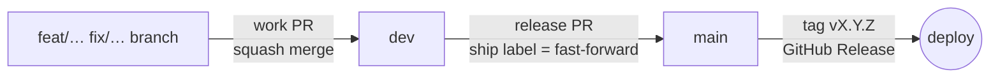

# @ebalzan/ci

One set of CI/CD rules for all your GitHub repos:

- **Composite GitHub Actions**: they open work and release PRs with AI descriptions, check every PR, and cut semver releases from Conventional Commits.
- **A CLI** (`ebalzan-ci`): it onboards a repo and keeps its Actions variables, secrets, settings and branch rulesets in sync.
- **A commitlint `commit-msg` hook** and a **Renovate preset** for the shared tooling.

Repos call the actions pinned to a major tag (`ebalzan/ci/actions/<name>@v2`), so fixes reach every repo with each release, with nothing to copy around.

## The git flow



There are three kinds of branch, and history stays **linear**: no merge commits anywhere.

| Branch                 | Lives       | Gets changes by                                  | Rewritten?                                 |
| ---------------------- | ----------- | ------------------------------------------------ | ------------------------------------------ |
| `<type>/<description>` | hours, days | your commits                                     | yes, by you (rebase, `--force-with-lease`) |
| `dev`                  | forever     | squash-merged work PRs                           | never                                      |
| `main`                 | forever     | the Release workflow fast-forwarding it to `dev` | never                                      |

### 1. Work on a branch

Branch off `dev`. The branch name is `<type>/<description>`, where `<type>` is one of the [work types](#work-types):

```sh
git switch dev && git pull
git switch -c feat/search-filters
git commit -m "feat: add search filters"     # Conventional Commits, checked by the hook
git push -u origin feat/search-filters
```

**Auto PR** opens a PR into `dev` on that push. It sets:

- the title: the first commit whose type is the branch's type;
- the type label, with you as the assignee;
- the milestone and the project board, when the repo configures them;
- an AI-written description.

It opens the PR as a draft and marks it ready for review once all of that is done.

While you work, keep the branch on top of `dev` by **rebasing, never merging**. The branch is yours, so rewriting it is fine:

```sh
git fetch && git rebase origin/dev
git push --force-with-lease
```

Optionally, tidy the commits before review: commit fixes with `git commit --fixup <sha>`, then fold them in with `git rebase -i --autosquash origin/dev`.

### 2. Merge the work PR into dev (squash)

**PR Checks** (`pr-check / Work PR`) must pass:

- the PR title and every commit follow Conventional Commits;
- the base is `dev`;
- the branch is `<type>/…`, and the title's type matches the branch's type;
- it has the type label and an assignee, and the author is the owner, a member or a collaborator;
- it has the milestone and is on the board, when those are set;
- it has a description.

It warns about large PRs, breaking changes and a branch that is behind `dev`.

Then **squash-merge** it. The PR title becomes the one commit on `dev`, and that commit is what drives the next version.

### 3. The release PR (dev → main)

Every push to `dev` makes **Auto PR** open or update **the** release PR, `dev` → `main`:

- **Title:** the release it will cut, e.g. `feat: release v1.4.0`. git-cliff computes it from the commits since the last tag.
- **Description:** an AI summary above the changelog.
- **Label:** `release`.

Its check (`pr-check / Release PR`) holds it to the computed title. It also requires the label, an assignee, the milestone and board when they're set, and a description. Finally, `dev` must contain `main` and must not contain a merge commit.

### 4. Ship it with the `ship` label, never the merge button

When the release PR's check passes, **add the `ship` label**. The **Release** workflow then does this:

1. **Verify.** `dev` is still the PR's head, `main` fast-forwards to it, there's no merge commit, and the PR check passed. If the check is still running, it waits.
2. **Version and tag.** It recomputes the title and requires it to equal the PR's. In a Node repo it commits `chore(release): X.Y.Z` to bump `package.json`. Then it pushes **`main` and `dev` to that same commit**, along with `vX.Y.Z` and the moving major tag `vX`, in **one atomic push**.
3. **Publish.** It creates the GitHub Release `vX.Y.Z`, using the PR's description as the notes.
4. **Deploy.** It calls the repo's own `.github/workflows/deploy.yml` with the new tag.

GitHub then marks the release PR as merged. `main` got exactly `dev`'s commits, with the same SHAs. `dev` and `main` end on the same commit, so the next release starts clean and no open work branch is disturbed.

If something moved in the meantime, nothing is pushed: remove the label and add it again. If someone merges the release PR with a GitHub button anyway, the job fails and prints the command that puts `main` back. Squash and rebase both rewrite `dev`'s commits, which would make `main` and `dev` diverge.

> There's no hotfix path straight to `main`. A fix goes `fix/…` → `dev` → release PR like any other change. `main` only ever moves through a release.

## Work types

[`config/types.json`](config/types.json) is the only place a type is defined. Each type works as a branch prefix, a Conventional Commit and PR-title type, and a PR label.

| Type                                                                               | Release |
| ---------------------------------------------------------------------------------- | ------- |
| `feat`                                                                             | minor   |
| `fix`, `refact`, `perf`, `revert`, `build`, `ci`, `docs`, `test`, `style`, `chore` | patch   |

A `!` after the type (`feat!: …`), or a `BREAKING CHANGE:` footer, makes any type a **major** release, from 0.x too. A repo with no tag yet starts at `v0.1.0`. Note that the type is `refact`, not `refactor`.

## Branch protection

`ebalzan-ci sync` applies these rulesets ([`config/rulesets/`](config/rulesets)) and repository settings ([`config/repo-settings.json`](config/repo-settings.json)):

| Ruleset                            | Default  | Effect                                                                                     |
| ---------------------------------- | -------- | ------------------------------------------------------------------------------------------ |
| `ci: protect main`                 | active   | no deletion, no force-push, linear history                                                 |
| `ci: protect dev`                  | active   | no deletion, no force-push, linear history                                                 |
| `ci: require pull request`         | disabled | `dev` changes only via a squash-merged work PR that passed `pr-check / Work PR`            |
| `ci: require release pull request` | disabled | nobody but GitHub Actions can update `main`, so the release PR's merge buttons are blocked |

**Settings:** squash merge only, with the PR title as the commit title. Merge commits and rebase merges are off. Head branches are deleted on merge.

The two disabled rulesets need the GitHub Actions app to be able to bypass them, because the release pushes with `GITHUB_TOKEN`. Enable one per repo with `.github/rulesets/<file>.json` containing `{ "enforcement": "active" }`, run one release, and confirm it went through.

## Getting started

Requirements:

- Node >= 22.12;
- [`gh`](https://cli.github.com), authenticated with admin rights on the repo.

### 1. Shared secrets (once)

```sh
cp config/secrets.env.example config/secrets.env   # in a checkout of this repo, or ~/.config/ebalzan-ci/
```

| Secret              | Used for                                                                                                                     |
| ------------------- | ---------------------------------------------------------------------------------------------------------------------------- |
| `ANTHROPIC_API_KEY` | the AI descriptions of work and release PRs. Without it, PRs keep the commit list or the changelog.                          |
| `GH_PROJECT_TOKEN`  | a **classic** PAT (`repo` + `project`), so the PRs Auto PR opens trigger PR Checks and can reach a user-owned Projects board |

### 2. Onboard a repo

In the repo's checkout:

```sh
npx @ebalzan/ci onboard
```

`onboard` does the following:

1. Creates the branch `ci/onboard-ebalzan-ci` from `dev`.
2. Writes the workflows (`auto-pr.yml`, `pr-checks.yml`, `release.yml`, and a starter `deploy.yml`), plus `.github/actions.env` and `renovate.json`.
3. For a Node repo, adds the husky `commit-msg` hook, the `@ebalzan/ci` and `husky` devDependencies, and the shared Prettier and ESLint config.
4. Gitignores the secrets files and commits everything.
5. Creates `dev` if it's missing, runs `sync`, and pushes.

Auto PR then opens the onboarding PR into `dev`. Squash-merge it. Run `npx @ebalzan/ci onboard --help` for the options (`--ref`, `--runs-on`, `--force FILE`, `--no-npm`, `--no-push`, `--dry-run`, …).

Then:

- add the repo's own build, test and lint jobs to `.github/workflows/pr-checks.yml` (it has a commented example);
- put what ships a release into `.github/workflows/deploy.yml`. It's the repo's own file, and `onboard` never overwrites it.

### 3. Keep it in sync

```sh
npx @ebalzan/ci sync --dry-run   # see the plan
npx @ebalzan/ci sync
```

Each setting comes from two layers, and the repo's own value wins:

| What                | Shared (every repo)           | The repo's own                     |
| ------------------- | ----------------------------- | ---------------------------------- |
| variables           | `config/actions.env`          | `.github/actions.env`              |
| secrets             | `<secrets>/secrets.env`       | `.github/secrets.env` (gitignored) |
| environment secrets | `<secrets>/secrets.<env>.env` | `.github/secrets.<env>.env`        |
| repository settings | `config/repo-settings.json`   | `.github/repo-settings.json`       |
| branch rulesets     | `config/rulesets/<file>.json` | `.github/rulesets/<file>.json`     |

How the layers combine:

- **JSON files** deep-merge.
- **Shared variables** are read by the actions at run time, never copied onto repos, so changing one only needs a release of this package.
- **Removals:** `--prune` deletes what no file defines.

## Configuration

Repo variables (`.github/actions.env`) or the shared `config/actions.env`:

| Variable                                       | Default        | Effect                                                        |
| ---------------------------------------------- | -------------- | ------------------------------------------------------------- |
| `AUTO_PROJECT_NUMBER`                          | none           | the Projects (v2) board every PR must be on                   |
| `AUTO_PROJECT_OWNER`                           | the repo owner | that board's owner                                            |
| `AUTO_MILESTONE_TITLE`                         | none           | the milestone every PR must have                              |
| `AUTO_MAX_CHANGED_LINES`                       | `500`          | work PRs over this get a size warning                         |
| `AUTO_DESCRIBE_MODEL` / `AUTO_DESCRIBE_EFFORT` | shared         | the Claude model, and its effort, that writes PR descriptions |

## What's inside

| Path                                | What                                                                              |
| ----------------------------------- | --------------------------------------------------------------------------------- |
| `actions/auto-pr`                   | opens or updates the work PR of a branch, or the release PR of `dev`              |
| `actions/pr-checks`                 | commitlint on the title and commits, then Danger rules for the PR's kind          |
| `actions/release`                   | verifies, fast-forwards, tags and publishes the release on the `ship` label       |
| `bin/`, `lib/`                      | the `ebalzan-ci` CLI: `onboard`, `sync`, `commit-msg`                             |
| `templates/`                        | the files `onboard` writes into a repo                                            |
| `config/`                           | types, shared variables, repo settings, rulesets, the git-cliff config            |
| `renovate/tooling.json`             | Renovate preset for the shared tooling (`github>ebalzan/ci//renovate/tooling#v2`) |
| `commitlint.config.mjs`, `scripts/` | the commit rules, the release title and the changelog                             |

## Upgrading from v1

In v1, the release PR was merged with a merge commit. In v2 it ships with the `ship` label (a fast-forward). Repos pinned to `@v1` keep working until they move. Per repo, **between two releases**:

1. If `git rev-list --merges origin/main..origin/dev` prints anything (an unreleased `Merge branch 'main' into dev`), rebase it away once, before syncing:
   `git switch dev && git rebase origin/main && git push --force-with-lease`.
2. Refresh the workflows. `release.yml` is required; `deploy.yml` is kept:
   ```sh
   npx @ebalzan/ci@2 onboard --ref v2 \
     --force .github/workflows/release.yml --force .github/workflows/pr-checks.yml \
     --force .github/workflows/auto-pr.yml --force renovate.json
   ```
3. Apply the new settings and rulesets with `npx @ebalzan/ci@2 sync`. Drop any `allow_merge_commit: true` override in `.github/repo-settings.json`.
4. Squash-merge the onboarding PR into `dev`, then release by adding the `ship` label to the release PR.

Do steps 2–4 together. The old `release.yml` expects a merge commit, and step 3 turns merge commits off.

## Developing this repo

```sh
npm ci
npm run check          # bash -n / node --check on every script
npm run lint           # ESLint, zero warnings
npm run format:check   # Prettier
npm test               # node:test, on throwaway git repos with a stubbed gh
```

The same flow applies here: work branches squash into `dev`. This repo has no workflows of its own, so release it by hand, with a fast-forward rather than a merge commit:

```sh
git switch main && git merge --ff-only dev && git push
```

## License

[MIT](LICENSE)
