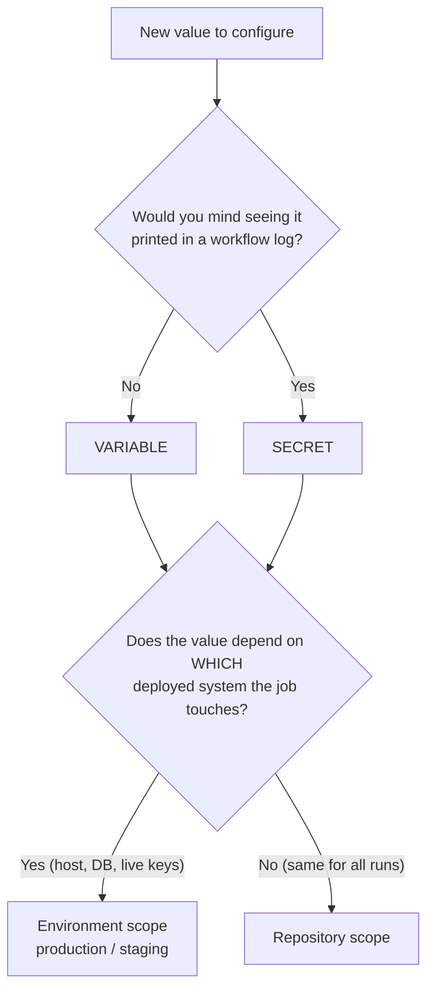

# GitHub Actions — secrets & variables

Where every Actions secret and variable lives, **why it lives there**, how
shared values reach every repo, and how one command syncs it all. Read
[§1](#1-the-rule) before adding any new value, and [§2](#2-shared-vs-repo-the-layers)
before deciding whether it goes in the shared layer or in a repo.

The tools: `ebalzan-ci bootstrap` sets values, `ebalzan-ci reset` deletes them
([CLI.md](CLI.md)). Every key, with its default: [CONFIGURATION.md](CONFIGURATION.md).

---

## 1. The rule

> **Environments** hold config that describes **a specific running system you
> deploy to**.
> **Repository** ("Settings → Secrets and variables → Actions") holds config
> that describes **the repository's own automation**.

That is the whole decision. It is _not_ "production goes in Environments" and
_not_ "the sensitive ones go in Environments". The only question is:

**Does this value point at, or grant access to, one particular deployed
system?**

- **Yes** → environment secret/variable, in the environment named after that
  system (`production`, `staging`). Examples: a host address, an SSH key, a
  database URL, a registry pull token used _by that host_, live-vs-test API keys
  of a third party.
- **No — it configures the repo's own bots and CI** → repository
  secret/variable. Examples: an LLM key used to write PR descriptions, a PAT for
  the project board, lint/label tuning.



### Why the rule is the rule

Environments are not a folder. They change _who can read the value_:

1. **Reachability gating.** An environment secret is invisible to any job that
   does not declare `environment: <name>`. `AWS_DEPLOY_ROLE_ARN` cannot be read by
   `pr-checks.yml` — not by convention, by mechanism. A repository secret is
   readable by **every job in every workflow** in the repo.
2. **Deployment history.** The Environments page records which release went to
   `production` and when.
3. **Protection rules** (required reviewers, wait timer, branch policy) — free
   on public repos, **paid on private ones**, see [§3](#3-plan-reality).

Point 1 is the reason to use environments at all. Everything else follows from
it: put a value in an environment when you want it _unreachable_ from jobs that
have no business with that system.

### Precedence — most specific wins

Both secrets and variables exist at two scopes here, and they are **not
merged**; the nearest one wins:

```text
environment  >  repository
```

(GitHub has a third, wider scope — organization — but personal accounts have
none, and the tools never write to it. That is why the shared layer here is
read at run time for variables and merged in at sync time for secrets: see
§2. It works the same for repos owned by an organization.)

So defining e.g. `DEPLOY_HOST` at the repo _and_ on the `production`
environment means `environment: production` jobs get the environment value
and everyone else gets the repo value. That is a legitimate **override**, but
only do it on purpose — an accidental duplicate is the hardest Actions bug to see,
because both values are masked in logs.

### Secret or variable?

Same two scopes, different visibility. **Variables are plain text** — printed
in logs, readable by anyone who can view repo settings. Secrets are masked and
write-only after creation. If you would not paste it into a public issue, it is
a secret. Non-secret-but-environment-specific config (a region, a health-check
URL, a log level) is a legitimate **environment variable** — the two axes are
independent.

---

## 2. Shared vs repo: the layers

> **A value goes in the shared layer only when it is the same for every repo.**
> Anything that differs — a board number, a deploy host, a milestone — is that
> repo's, and lives in that repo.

```text
                  shared (lower precedence)               <repo>/.github/ (wins)
variables         config/actions.env                  +   actions.env              → shared read at run time; repo's → repository variables
repo secrets      <shared secrets dir>/secrets.env    +   secrets.env ¹            → repository secrets
env secrets       <shared secrets dir>/secrets.<env>.env + secrets.<env>.env ¹    → environment <env> secrets
```

`config/actions.env` ships inside this repo (and the npm package). The
**shared secrets dir** is wherever you keep your shared secrets — they are never
committed: `$CI_SECRETS_DIR` if set, else `config/` when you run the tools from
a git checkout of ebalzan/ci, else `~/.config/ebalzan-ci/`.

¹ A repo's own secrets files live in `repos/<owner>/<repo>/` inside the shared
secrets dir when that folder exists — recommended: every repo's secrets in one
place, outside any git working tree, synced without checkouts. Otherwise they
are the gitignored files in the repo's `.github/`.

The two columns combine key by key — **the repo's value wins**. For secrets,
`bootstrap` merges them and writes the result onto the repository. For
variables it pushes only the repo's column; the shared one is read at run time
(below). So a repo can:

- **inherit** a shared key by not mentioning it;
- **override** it by setting the same key in its own file;
- **add** any key of its own, in any scope (including a new environment: the
  file `secrets.staging.env` creates and fills environment `staging`).

The dry run labels every key `shared`, `repo`, `repo (overrides shared)` or
`repo (same as shared: redundant)` — delete the redundant ones from the repo's
file so the repo keeps only what is really its own.

**Shared variables are read at run time.** In a reusable workflow `vars` are
the caller repo's — but `config/actions.env` is committed, and the runner
downloads the whole of ebalzan/ci for `uses: ebalzan/ci/actions/…@v2`. So the
actions (`actions/auto-work-items/src/sharedVars.ts`, also used by
`scripts/release/promote-dev-to-main.mjs`) load that file and fill every key
the repo leaves unset. Consequences:

- A shared variable changes when it is released and **the major tag moves** —
  no bootstrap run, and nothing stale is left on any repo.
- A repo's Settings page shows only its own variables; the run log line
  `Shared variables from config/actions.env: …` lists what was filled.
- The shared workflows pass the repo's variables whole
  (`REPO_VARS_JSON: ${{ toJSON(vars) }}`), so any `AUTO_*` key a repo sets
  reaches the actions with no workflow edit.
- Only the shared actions see shared variables. A workflow that lives in a repo
  and reads `vars.X` itself must have `X` in that repo's `actions.env`.
- An empty repo variable counts as unset, so a repo cannot blank out a shared
  value — override it with a real one.

**Shared secrets are merged at sync time** — they are not committed, so there
is nothing to read at run time. After changing one, re-run
`ebalzan-ci bootstrap --all`.

**Removing a key** from a file does not delete it on GitHub. `--prune` deletes
every variable/secret in a synced scope that no layer defines (after listing
them and asking). Environments that no file names are never touched.

---

## 3. Plan reality

What the GitHub plan decides, for the repos this targets:

| Feature                                                       | Public repo | Private, free plan | Private, Pro/Team |
| ------------------------------------------------------------- | ----------- | ------------------ | ----------------- |
| Environments and environment secrets                          | ✅          | ✅                 | ✅                |
| Environment protection rules (required reviewers, wait timer) | ✅          | ❌                 | ¹                 |
| Branch rulesets ([REPO_RULES.md](REPO_RULES.md))              | ✅          | ❌ (skipped)       | ✅                |
| Organization-level secrets/variables                          | org only    | org only           | org only          |

¹ At the time of writing GitHub's docs reserve required reviewers and wait
timers on private repos for GitHub Enterprise; check the current plan matrix
before relying on them. Environments themselves (and their secrets) were
verified working on private free-plan repos.

Without required reviewers, **merging the `dev → main` promotion PR is the
deploy approval**: review it as the approval it is.

---

## 4. File mechanics

| File                                              | Contains                             | Committed?   |
| ------------------------------------------------- | ------------------------------------ | ------------ |
| `config/actions.env`, `.github/actions.env`       | variables                            | ✅ Yes       |
| `secrets.env` (shared dir), `.github/secrets.env` | repository secrets                   | ❌ **Never** |
| `…/secrets.<env>.env`                             | secrets for GitHub environment `env` | ❌ **Never** |
| `…/secrets*.env.example`                          | placeholders / templates             | ✅ Yes       |
| `.github/bootstrap.conf`                          | per-repo tool settings (below)       | ✅ Yes       |

Secrets files kept in a checkout must be gitignored — `onboard` adds
`/.github/secrets*.env` (keeping the `.example` files) to `.gitignore`.

> **The filename is the destination.** `actions.env` / `secrets.env` land on
> the repository; a `.<name>` infix always targets the GitHub environment it is
> named after.

- **`_FILE` suffix.** A secret key ending in `_FILE` is a path: the secret is
  created under the stripped name from that file's **contents** (dotenv cannot
  hold a multiline value). `~` expands; a relative path is relative to the env
  file. `FOO_FILE` in one layer and `FOO` in the other are the same key.
- **Local-only keys.** `LOCAL_ONLY_KEYS=A B C` in a repo's
  `.github/bootstrap.conf` are never pushed — for values only a local tool
  reads (a provisioning script, say).
- **Guards.** Empty values and placeholders (`xxxx`, `sk-ant-xxx`,
  `github_pat_xxx`) are refused: a secret cannot be read back to notice a bad
  write. A missing secrets file is seeded from its `.example` on first run.
- **Remote mode** (`bootstrap -R owner/repo` with no local checkout) reads the
  repo's committed files through the API and its secrets from
  `repos/<owner>/<repo>/`. Without that folder it syncs only the shared secrets,
  and never prunes secrets.

Real secrets never enter git. These are **Actions** secrets, unrelated to any
app's runtime `.env`.

---

## 5. Setup

### Prerequisites

1. **GitHub CLI** — <https://cli.github.com> (`gh --version`), authenticated
   with the `project` scope if you use boards: `gh auth login && gh auth refresh -s project`.
2. **Admin** on every target repo.
3. Each repo's own secrets in `~/.config/ebalzan-ci/repos/<owner>/<repo>/` —
   then `--all` needs no checkouts. (Alternatively in each checkout's
   `.github/`, with the repos side by side under `CI_REPOS_ROOT`.)

### Fill in the secrets

```bash
mkdir -p ~/.config/ebalzan-ci
cp "$(npx --no-install ebalzan-ci path)/config/secrets.env.example" ~/.config/ebalzan-ci/secrets.env
$EDITOR ~/.config/ebalzan-ci/secrets.env
# plus each repo's own, e.g.:
mkdir -p ~/.config/ebalzan-ci/repos/owner/my-api
$EDITOR ~/.config/ebalzan-ci/repos/owner/my-api/secrets.production.env
```

> **Why a separate `GH_PROJECT_TOKEN`?** The built-in `GITHUB_TOKEN` cannot write
> to Projects (v2) boards, which are owned by the account, not the repo — and a
> PR it opens does not trigger other workflows, so PR Checks would not run on
> the bots' PRs.
>
> **Why classic and not fine-grained?** Fine-grained PATs expose a `Projects`
> permission only under **Organization** permissions. There is no account-level
> equivalent, so a fine-grained token cannot reach a board owned by a personal
> account. A classic PAT with the `project` scope is the only option there. It
> also needs `repo`, because the automation creates issues and pull requests,
> not just reads them.
>
> The trade-off: `repo` on a classic PAT covers **every** repository the account
> can reach and cannot be narrowed to selected repos. Keep the expiry short, and
> reissue rather than extend. One token serves every repo; the bootstrap writes
> it as a repository secret in each of them, from one line in the shared
> `secrets.env`.

### Run the bootstrap

```bash
ebalzan-ci bootstrap --all --dry-run          # preview every repo — run this first
ebalzan-ci bootstrap --all                    # sync every repo
ebalzan-ci bootstrap -C ../my-repo            # one repo, from its checkout
ebalzan-ci bootstrap -R owner/my-repo         # one repo, no checkout
```

It is idempotent — re-run it to update any value; nothing needs clicking
together in the GitHub UI. Options: [CLI.md](CLI.md#bootstrap).

---

## 6. Verify

```bash
gh variable list --repo owner/my-repo
gh secret   list --repo owner/my-repo
gh secret   list --repo owner/my-repo --env production
```

Repository values are under **Settings → Secrets and variables → Actions**;
environment values under **Settings → Environments → _name_**. Then the real
check: push a branch (work items appear) and open a PR (title check green).

---

## 7. Resetting / deleting

Prefer `bootstrap --prune` to remove keys no file defines any more.
`ebalzan-ci reset` is the blunt tool: it lists what exists, then requires a
typed confirmation. Always `--dry-run` first.

```bash
ebalzan-ci reset -R owner/my-repo --dry-run           # repo variables that would go
ebalzan-ci reset -R owner/my-repo --include-secrets   # variables + repo secrets
ebalzan-ci reset -R owner/my-repo --match '^AUTO_'    # only matching names
ebalzan-ci reset -R owner/my-repo --env production --secrets-only --dry-run
```

---

## 8. Troubleshooting

| Symptom                                             | Cause / fix                                                                                                                                   |
| --------------------------------------------------- | --------------------------------------------------------------------------------------------------------------------------------------------- |
| Secret is set but the job sees an **empty string**  | The job does not declare `environment:`. Environment secrets resolve **only** inside a job that names the environment — no error, just empty. |
| Shared change has no effect in a repo               | Secret: not re-synced (`--all`). Variable: not released yet, or the repo overrides that key — the dry run says which.                         |
| Key removed from a file still on GitHub             | Removal never deletes. Re-run with `--prune`.                                                                                                 |
| Two scopes, wrong value wins                        | Precedence is environment > repository. Delete the duplicate you did not mean to create.                                                      |
| `gh is not authenticated`                           | `gh auth login`, then `gh auth refresh -s project`.                                                                                           |
| `… is still a placeholder` / `… has an empty value` | Fill the value in, or comment the line out.                                                                                                   |
| Multiline secret arrives mangled                    | Use the `_FILE` suffix.                                                                                                                       |
| `Could not verify …/projects/N`                     | `gh auth refresh -s project`, or fix `AUTO_PROJECT_NUMBER` in the repo's `actions.env`.                                                       |
| Shared secrets not picked up                        | Check the `shared secrets:` path the bootstrap prints; set `CI_SECRETS_DIR` if it is not where your file is.                                  |

Naming constraints: names are case-insensitive, cannot start with `GITHUB_` or a
digit, and secrets are capped at 48 KB (100 per repo, 100 per environment).
